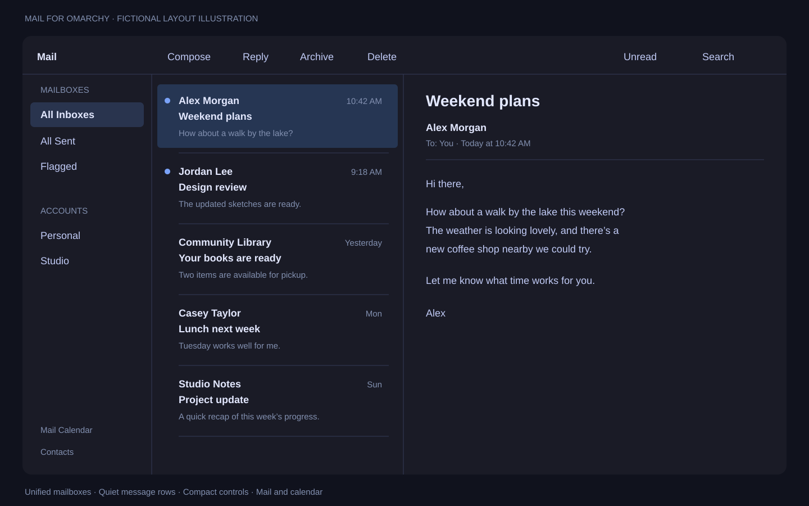

# Mail for Omarchy



A small Omarchy launcher plugin for [Evolution for Omarchy](https://github.com/samcapshaw/evolution-omarchy), an unofficial Evolution fork with an Apple Mail inspired layout and Tokyo Night colors. The preview is an illustration using fictional messages, not a screenshot of a real mailbox.

The app offers All Inboxes, All Sent and Flagged mailboxes; a side-by-side reading pane; padded rows with body previews; an unread filter; a compact compose toolbar; an icon rail; and month/week calendar controls. Accounts use Evolution's normal sign-in. This plugin opens the app; it does not implement mail synchronization itself.

## Manual app setup required

The marketplace plugin does **not** download, compile or install the mail app. It never installs packages or invokes privileged commands. Build the app separately before enabling this plugin. The fork currently targets Evolution **3.60.2** and needs compatible Evolution Data Server and EWS modules. Check installed versions before building; rebuilding may be required after system updates.

Dependencies for the plugin: Omarchy Quattro/Quickshell and Python 3; `notify-send` is optional for setup notifications. The app uses GTK 3, WebKitGTK, Evolution Data Server, and Evolution's other native dependencies. Google and Microsoft365 support requires compatible packaged `evolution-ews` components. Consult the fork's README and CMake dependency checks for the full build requirements.

From a terminal, explicitly install the documented build prerequisites:

```sh
omarchy pkg add evolution evolution-ews cmake ninja intltool glib2-devel
```

Clone the app and use the reviewed source revision:

```sh
git clone --branch omarchy https://github.com/samcapshaw/evolution-omarchy.git
cd evolution-omarchy
git checkout bfbcbabf1020a9c80c830656fa909816a606f993
./omarchy/build.sh
# Close Evolution before installing. Review the effects below first.
./omarchy/install.py
# Optional one-time layout defaults; backs up existing settings:
./omarchy/preferences.py
```

**App installer effects:** the separate installer copies the build into `~/.local/opt/evolution-omarchy`, replaces `~/.local/bin/evolution`, creates Mail and Evolution desktop overrides/icons, copies the app stylesheet, and adds missing unified search-folder rules. It also updates existing userapp Evolution launchers. Back up any existing files at those paths before running it. Running the installer is explicit consent to those changes. The optional preferences script changes Evolution settings; do not run it on every launch. No accounts or credentials are supplied in either repository.

## Install and use the plugin

```sh
omarchy plugin add https://github.com/samcapshaw/omarchy-mail.git --enable
omarchy-shell omarchy-mail open
```

An optional Mail button can be added through Omarchy's bar configuration. The plugin prefers the installed `bin/omarchy-mail` runtime wrapper when available, so bundled libraries and schemas are loaded together. Older installations use `~/.local/opt/evolution-omarchy/bin/evolution`, falling back to the existing `evolution-personal` prefix for earlier installations. To use another absolute prefix, set `EVOLUTION_OMARCHY_PREFIX` in the desktop session environment. A configured prefix does not fall back to another app if missing. The plugin does not start Mail automatically when enabled.

## Remove or recover

```sh
omarchy plugin remove io.github.samcapshaw.mail
```

Removing or disabling the plugin leaves the installed app, mail, calendars, account settings and credentials in place. The plugin itself creates no launchers or user data.

To remove the separate app, close it first. Remove the dedicated `~/.local/opt/evolution-omarchy` directory and restore your backups of `~/.local/bin/evolution`, the `org.omarchy.Mail.desktop` and `org.gnome.Evolution.desktop` entries under `~/.local/share/applications`, any modified `userapp-Evolution-*.desktop` entries, the copied app/action icons under `~/.local/share/icons/hicolor/scalable`, and `~/.config/evolution/omamail.css`. Restore search-folder rules and optional settings from your backups if desired. Do not delete Evolution's account, mail, calendar or credential directories. Packaged Evolution remains available at `/usr/bin/evolution`.

## Privacy, license and validation

The launcher reads only application paths and starts a local executable. It does not read mail, calendars, signatures or credentials and makes no network requests. The launched Evolution app accesses accounts normally. This repository contains original integration code and a fictional preview only; no personal mailbox content or account data.

The integration and illustration are MIT licensed (see LICENSE). The separate Evolution fork retains its upstream licenses; it is not relicensed by this plugin. Unofficial and not affiliated with Omarchy, GNOME or Apple.

Launcher tests cover absent installations, executable checks, configured prefixes, and avoiding fallback to the system app. Run `python3 -m unittest -v`. The source app has been compiled and exercised on an Omarchy desktop; see its README for validation and limitations.
